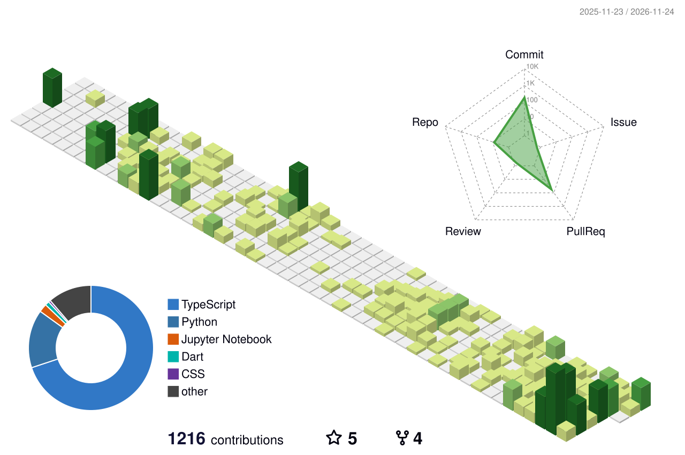

# Kunal Khairnar

Computer Engineering student. I like taking complex systems apart to understand how they work underneath. I also draw and paint, and that background shapes how I approach design and problem solving in code.

[Email](mailto:kunalkhairnar2005@gmail.com) · [LinkedIn](https://www.linkedin.com/in/kunal-khairnar-63b5b522a) · [Instagram](https://www.instagram.com/k_hairnar.k_unal05/) · `sinix`

## Tech stack

| Area | Tools |
|---|---|
| **Languages** | Python · Java · C++ · JavaScript · HTML · CSS · SQL · Solidity |
| **Apps and cloud** | React · Next.js · Flutter · Android · MongoDB · Firebase · Docker · AWS · Vercel |
| **Machine learning** | TensorFlow · scikit-learn · pandas · NumPy · ONNX Runtime |

## Contributions

<!-- 3D contribution chart: remove these comment markers once the GitHub-Profile-3D-Contrib workflow has run successfully.
<picture>
  <source media="(prefers-color-scheme: dark)" srcset="./profile-3d-contrib/profile-night-green.svg" />
  
</picture>
-->

  
  

## Badges

