<picture>
  <source media="(prefers-color-scheme: dark)" srcset="./assets/dark/header.svg" />
  
</picture>

<a href="mailto:kunalkhairnar2005@gmail.com"><picture><source media="(prefers-color-scheme: dark)" srcset="./assets/dark/btn-email.svg" /></picture></a>
<a href="https://www.linkedin.com/in/kunal-khairnar-63b5b522a"><picture><source media="(prefers-color-scheme: dark)" srcset="./assets/dark/btn-linkedin.svg" /></picture></a>
<a href="https://www.instagram.com/k_hairnar.k_unal05/"><picture><source media="(prefers-color-scheme: dark)" srcset="./assets/dark/btn-instagram.svg" /></picture></a>
<a href="https://github.com/Kunal-Khairnar-05"><picture><source media="(prefers-color-scheme: dark)" srcset="./assets/dark/btn-github.svg" /></picture></a>

  

<picture>
  <source media="(prefers-color-scheme: dark)" srcset="./assets/dark/about.svg" />
  
</picture>

  

<picture>
  <source media="(prefers-color-scheme: dark)" srcset="./assets/dark/tech-stack.svg" />
  
</picture>

  

<picture>
  <source media="(prefers-color-scheme: dark)" srcset="./assets/dark/contributions.svg" />
  
</picture>

  

<picture>
  <source media="(prefers-color-scheme: dark)" srcset="https://streak-stats.demolab.com?user=Kunal-Khairnar-05&background=1e1f23&border=1e1f23&stroke=3a3c44&ring=ffffff&fire=ffffff&currStreakNum=ffffff&sideNums=ffffff&currStreakLabel=9da0a9&sideLabels=8a8d96&dates=8a8d96&border_radius=24" />
  
</picture>

  

 

